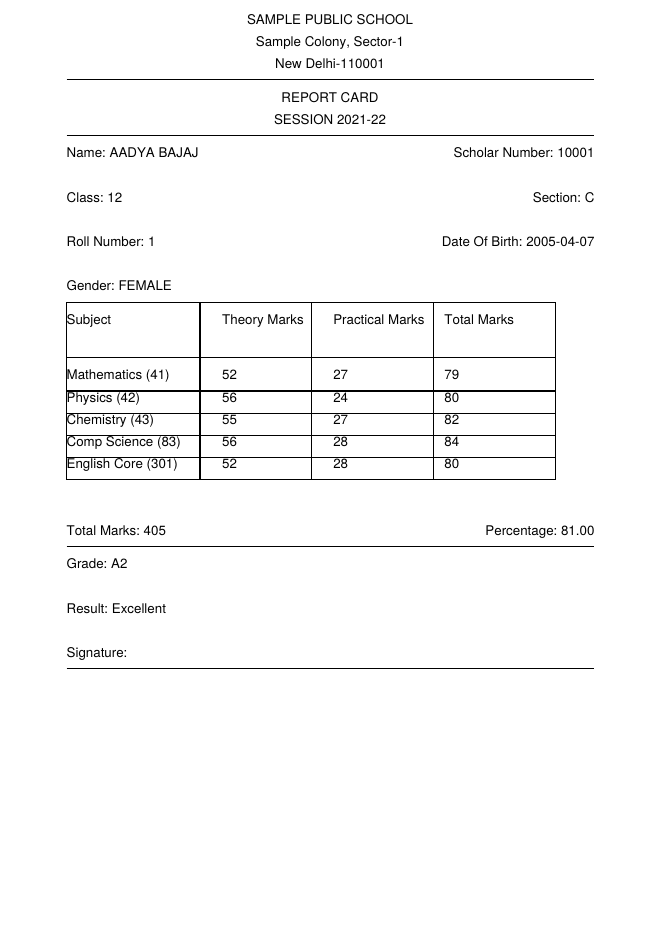
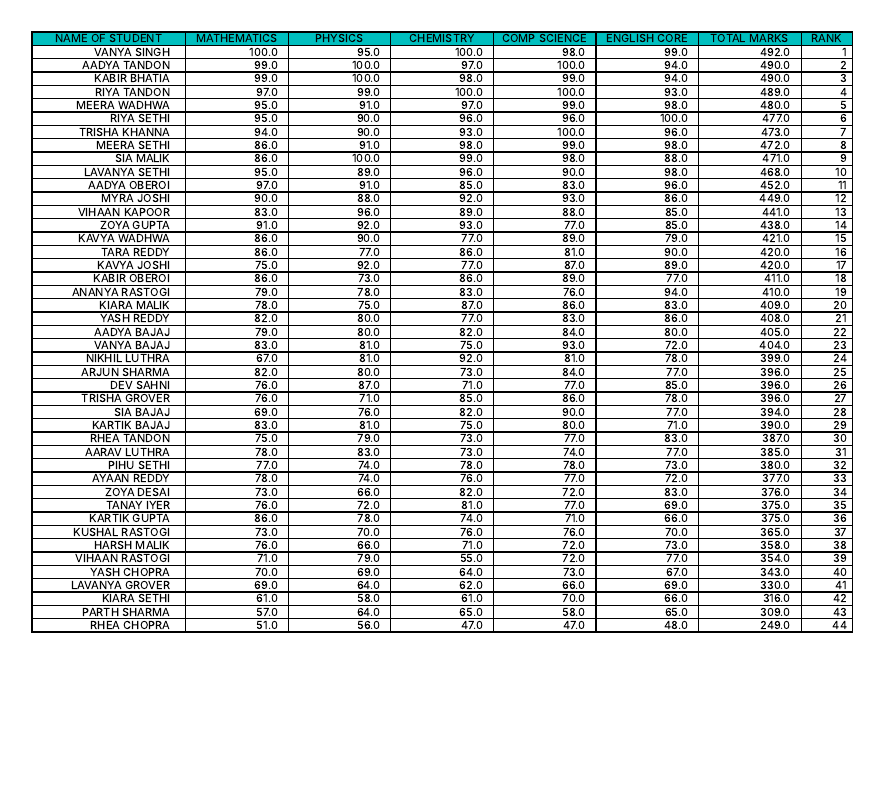
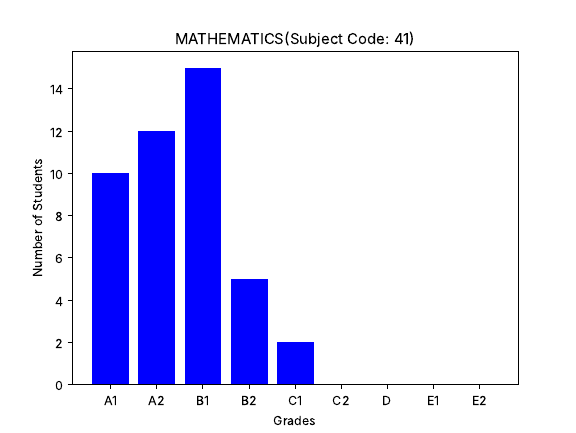
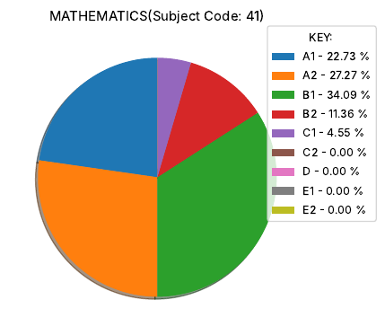

# Result Processing and Report Generation

A menu-driven desktop application (Python + Tkinter + MySQL) that helps teachers process exam results:
it validates the marks files received from subject teachers, merges them into a database, and then
publishes **PDF report cards** and **graphical analysis reports**.


## Features

| Menu | What it does |
|---|---|
| **File Operation → Upload & Validate Data** | Loads 5 subject-wise CSV files, reports missing files and record-count mismatches |
| **File Operation → Null Values Validation** | Flags blank values in any column of any file |
| **File Operation → Numeric Data Validation** | Flags text where numbers are expected |
| **File Operation → Merge Files & Generate Result** | Merges the files, computes subject totals and stores them in MySQL (all-or-nothing insert with rollback on error) |
| **Report Card → Publish Report Card** | One PDF report card per student for a chosen roll-number range |
| **Reports → Generate Reports** | Grade-wise bar chart, grade-wise pie chart, subject toppers list, overall class rank list (all PDF) |

## Tech stack
Python · Tkinter (GUI) · MySQL / `mysql-connector-python` · pandas · NumPy · Matplotlib · ReportLab

## Project structure

```
├── result_processing_app.py                        # the whole application as a plain Python script
├── data/
│   ├── Sub1_Marks.csv … Sub5_Marks.csv   # marks files "from subject teachers"
│   ├── student_master.csv                # 44 fictional students (Class 12-C)
│   ├── subject_master.csv                # subjects + max theory/practical marks
│   ├── grade_master.csv                  # grade bands A1 … E2
│   └── bad_examples/                     # broken files to demo the validation screens
├── sql/schema.sql                        # MySQL schema (optional, notebook creates it automatically)
├── generate_sample_data.py               # regenerates everything in data/
├── sample_output/                        # example PDFs produced by the app
├── output/                               # your generated PDFs land here (git-ignored)
├── requirements.txt
└── .env.example                          # database settings template
```

## Setup

```bash
pip install -r requirements.txt
```
On Ubuntu/Debian also run `sudo apt install python3-tk` (Tkinter already ships with Python on Windows and macOS).

### Option A: MySQL (default)
1. Make sure MySQL Server is running.
2. Copy `.env.example` to `.env` and put in your MySQL password (the `.env` file is git-ignored).
3. The notebook creates the database `cs_project`, the tables, and loads the master data automatically.

### Option B: SQLite (no server, quickest way to try it)
Set `DB_BACKEND=sqlite` in `.env`. Everything else is identical.

## Run
**Script:** run `python result_processing_app.py` from the project folder.

**Notebook:** 
1. Open `Result_Processing_and_Report_Generation.ipynb` in VS Code (with the Python + Jupyter extensions).
2. **Run All** (or run the cells top to bottom). The last cell opens the application window.
3. In the app: **Upload → Null check → Numeric check → Merge**, then **Report Card** and **Reports**.

> The window can open behind VS Code, so check the taskbar/dock. The GUI needs a desktop; it will not run in Google Colab.

To demo the validation messages, copy a file from `data/bad_examples/` over the matching file in `data/`,
for example `Sub2_Marks_NULL_VALUES.csv` → `Sub2_Marks.csv`, then run *Upload* and *Null Values Validation*.
Merging twice fails on purpose (primary key); run `reset_student_marks()` (last notebook cell) to repeat it.

## Sample output

| Report card | Class rank list |
|---|---|
|  |  |

| Grade-wise bar chart | Grade-wise pie chart |
|---|---|
|  |  |

All data in this repository is **fictional**.

## Database design (`cs_project`)

| Table | Purpose |
|---|---|
| `student_master` | Student details; `scholar_no` is the primary key |
| `subject_master` | Subject code, name, max theory / practical marks |
| `grade_master` | Grade code, description, percentage range |
| `student_marks` | Transaction table (`scholar_no` + `sub_cd`) filled from the CSV files; joined with the masters for all reports |


